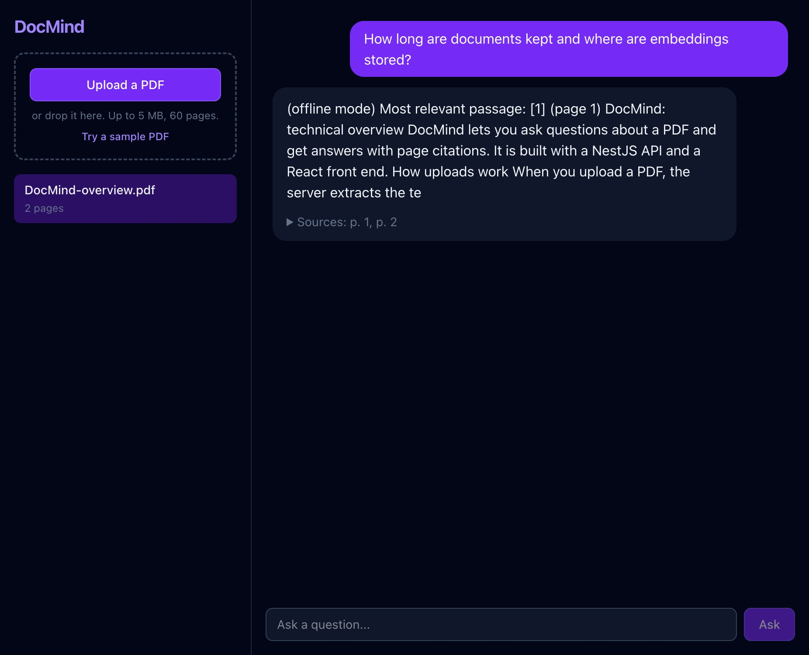

# DocMind - Chat with your PDFs

Upload a PDF and ask it questions. Answers stream in token by token and cite the pages they came from. A from-scratch **RAG (retrieval-augmented generation)** pipeline built with **NestJS**, **React**, **PostgreSQL + pgvector** and **Gemini**.

| | |
|---|---|
| Live demo | _added after deploy_ (click **Try a sample PDF**) |
| API docs (Swagger) | _added after deploy_ (`/docs`) |



## How it works

```
Upload   PDF -> extract text per page -> overlapping chunks (~1000 chars)
             -> embeddings (768-d) -> Postgres `vector` column (pgvector)

Ask      question -> embedding -> top-5 chunks by cosine distance (`<=>`)
             -> prompt with numbered excerpts -> LLM stream -> Server-Sent Events -> browser
```

- **Chunking** is page-aware (so answers can cite page numbers), splits on sentence boundaries and keeps an overlap so facts are not cut in half. Unit tested.
- **Retrieval** is a single SQL query: `ORDER BY embedding <=> $query LIMIT 5`, scoped to the document and the owner.
- **Streaming:** the API answers `POST /documents/:id/ask` with `text/event-stream` events `sources`, `token` (many), `done` / `error`. The React client reads the body as a stream (a `fetch` reader, since `EventSource` cannot POST). Closing the tab aborts the upstream LLM request.
- **Grounded answers:** the system prompt restricts the model to the retrieved excerpts and asks it to say so when the answer is not in the document.

## Built to survive the public internet

A demo with a free LLM key needs guardrails, so these are part of the design:

- **Per-visitor isolation** via an anonymous `x-session-id` UUID: one visitor can never read, ask about or delete another's documents (e2e tested)
- **Rate limiting** (NestJS Throttler): global, plus tighter limits on upload and ask
- **Global daily AI budget** (`DAILY_QUESTION_CAP`, default 200) stored in Postgres, returns `429` with a friendly message when exhausted
- **Upload limits:** PDF magic-number check, 5 MB, 60 pages, 300 chunks, 3 documents per visitor
- **Auto-cleanup:** documents are deleted after 24 hours
- Helmet, strict DTO validation (`whitelist` + `forbidNonWhitelisted`)

## Tech stack

| Layer | Tools |
|---|---|
| Frontend | React 19, Vite, TypeScript, Tailwind CSS 4 |
| Backend | NestJS, Prisma 7 (+ raw SQL for vector ops), `unpdf` for PDF text, Swagger, Throttler, Helmet |
| AI | Gemini embeddings (`gemini-embedding-001`, 768 dims) and Gemini Flash-Lite (`gemini-3.1-flash-lite`, fast and free-tier friendly) for generation, behind an `Llm` interface |
| Database | PostgreSQL with `pgvector` |
| Tests / CI | Vitest unit + e2e (real Postgres, real PDF upload, real vector search, SSE parsing), GitHub Actions |
| Hosting | Render (API), Vercel (web), Neon (Postgres with pgvector) |

The `Llm` abstraction has a deterministic offline implementation (`LLM_PROVIDER=fake`, hashed bag-of-words embeddings) so the whole stack, including tests and CI, runs without an API key or network.

## Run locally

```bash
docker compose up -d                  # Postgres + pgvector on :5436

cd apps/api
cp .env.example .env                  # set GEMINI_API_KEY, or LLM_PROVIDER=fake to run offline
npm install
npx prisma migrate deploy
npm run start:dev                     # http://localhost:3002  (docs at /docs)

cd ../web
cp .env.example .env
npm install
npm run dev                           # http://localhost:5173
```

Get a free Gemini key at https://aistudio.google.com/apikey.

## Tests

```bash
cd apps/api
npm test          # chunker unit tests
npm run test:e2e  # upload a generated PDF, vector search, SSE stream, isolation, daily cap, delete
```

## Possible next steps

- HNSW index on `embedding` (not needed per-document at this size, worth it for a shared corpus)
- Hybrid search (BM25 + vectors) and re-ranking
- Multi-turn memory and multi-document questions

## License

MIT
